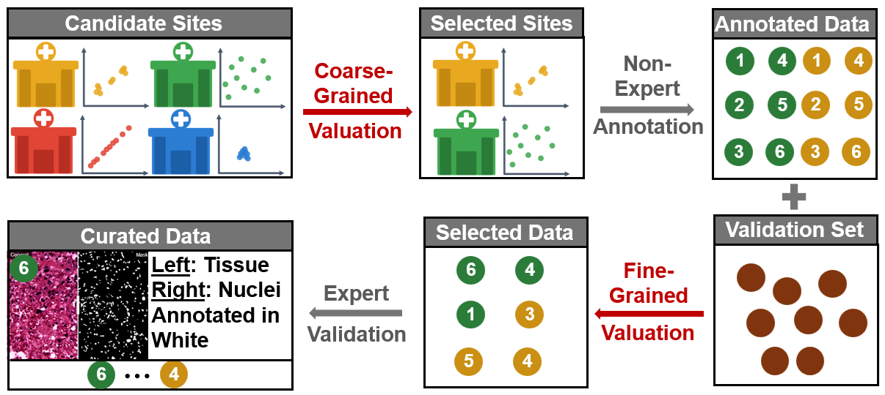

# Data Valuation

> This is the official code base for **"Data Valuation for Machine Learning: Experiments and Analyses [Experiment, Analysis & Benchmark]"**

Experimental benchmark for data valuation methods in machine learning, covering fine-grained and coarse-grained granularities across diverse datasets, tasks, and scales.

**Paper:** [accepted version](./paper.pdf) · [extended version](./paper-extended.pdf) (with the full parameter tuning, evaluation and scalability results)

## Abstract

Data valuation assigns a quantitative measure of importance to data with respect to a given objective. In machine learning, the objective is often model performance, but could more broadly be any measurable property of the learning pipeline. It enables a wide range of uses including efficient training set selection, informed data curation, robustness and fairness in ML, and the design of incentive-aligned data markets. This paper conducts the first comprehensive experimental evaluation of data valuation methods spanning different granularities of data value. First, we propose a unified formal framework that introduces two complementary notions of data value: (i) coarse-grained valuation, which assigns a scalar value to a dataset as a whole, and (ii) fine-grained valuation, which assigns a scalar value to subsets of the data. Two generic operators, data value aggregation and data value attribution, formalize the relationship between the two granularities. We show that the evaluated methods are recovered as instantiations of this framework. Second, we propose a taxonomy that classifies data valuation methods by the information they require from the learning pipeline. Third, we perform an extensive experimental evaluation of the efficiency/accuracy/memory trade-offs of state-of-the-art valuation methods across eleven datasets. We describe the strengths and limitations of the methods, share new insights about their inner workings, summarize key lessons learned, and pinpoint promising research directions in the field.

## Key Contributions

- **Unified framework and taxonomy.** A formal framework that unifies data valuation methods, distinguishing coarse- and fine-grained valuation with respect to a generic context and relating the two through aggregation and attribution operators, and a taxonomy that classifies methods by the information they require from the learning pipeline: the task, the model, and the level of model access. The evaluated methods are instantiations of the framework.
- **First experimental evaluation of both granularities.** Thirteen state-of-the-art methods (seventeen techniques counting variants), each tuned to its accuracy/efficiency Pareto frontier, on eleven tabular and image datasets from medicine, social science, gaming, biology and physics, in classification and regression, evaluated on accuracy, efficiency and memory.
- **Scalability study.** Scalability along dataset size (up to 7M points) and model class and size (up to 58M parameters): what the cost of each branch of the taxonomy scales with, and how high- and low-valued points change with the model. The study also characterizes what the validation set provides, through domain adaptation, and what it costs in accuracy and time.
- **Lessons and research directions.** Six lessons summarizing the results, to our knowledge not reported before, and the research directions they lead to. All artifacts are shared in this repository for reproducibility.

---
# Use Case

<p align="left">
  
</p>


## Repository Structure

```
data-valuation/
├── src/
│   ├── fine_grained/          # Extended OpenDataVal: Fine-grained valuation
│   │   ├── __main__.py        # CLI entry point (Typer)
│   │   ├── dataloader/        # Dataset fetching, noise injection, registration
│   │   ├── dataval/           # Valuation methods (KAIROS, DOOB, LoGRA, IR-DShapley, ...)
│   │   ├── experiment/        # ExperimentMediator orchestration harness
│   │   └── model/             # Models
│   └── coarse_grained/        # Coarse-grained valuation
│       ├── baselines/         # OT, RVol, DAVINZ (NTK-MMD)
│       ├── models/            # CNN, ResNet, MLP
│       ├── scripts/           # MPerf correlation & robustness & sensitivity experiments
│       └── utilities/         # helpers
├── Scripts/                   # Full data valuation pipeline (Adult, CIFAR-10, HEP mass 1K–7M, ...)
├── Plots/                     # Experiment results
│   ├── fine_grained/          # Per-dataset evaluation plots (Adult, CIFAR-10, DogFish, ...)
│   │   └── (tuning inside)    # parameter tuning results per dataset
│   └── Scalability/           # Scalability results for fine- and coarse-grained methods
├── data/                      # Datasets for reproducibility
├── requirements.txt
└── setup.py
```

## Setup

### Quick Install (Automated)
```bash
bash src/fine_grained/setup.sh
```

### Manual Install
```bash
# Clone repository
git clone https://github.com/validal/data-valuation.git
cd data-valuation

# Create Python 3.12 virtual environment
python3.12 -m venv finegrained_valuation
source finegrained_valuation/bin/activate  # Linux/Mac
# Or: finegrained_valuation\Scripts\activate  # Windows

# Install PyPI requirements
pip install -r requirements.txt

# Clone and install GhostSuite
git clone https://github.com/Jiachen-T-Wang/GhostSuite.git
pip install -e GhostSuite --no-deps

# Install modified opendataval
pip install -e src/fine_grained/opendataval
```

---

## Running Experiments

### Fine-grained Data Valuation

**HEPMass Variants (1K to 7M samples):**
```bash
python Scripts/run_hep1k_dataval.py
python Scripts/run_hep10k_dataval.py
python Scripts/run_hep100k_dataval.py
python Scripts/run_hep1m_dataval.py
python Scripts/run_hep7m_dataval.py
```

**CIFAR-10 with Different ResNets:**
```bash
python Scripts/run_cifar10_resnet9_dataval.py --method DOOB
python Scripts/run_cifar10_resnet18_dataval.py --method LoGRA
python Scripts/run_cifar10_resnet50_dataval.py --method InRunDataShapleyGhost
python Scripts/run_cifar10_resnet152_dataval.py --method Kairos
```

**Other Datasets:**
```bash
python Scripts/run_adult_dataval.py --method DataOob
python Scripts/run_connect4_dataval.py --method KNNShapley
python Scripts/run_dogfish_dataval.py --method LAVA
python Scripts/run_cifar10_base_dataval.py --method Random
```

### Fine-grained CLI
```bash
python -m src.fine_grained --help
```

### Coarse-grained Experiments
```bash
python src/coarse_grained/scripts/boostrap.py
python src/coarse_grained/scripts/robustness.py
```

---

## Running Experiments

```bash
# Fine-grained CLI
python -m src.fine_grained --help

# Fine-grained scripts
python Scripts/run_adult_dataval.py --method DataOob 
python Scripts/run_cifar10_dataval.py --method KNNShapley 
python Scripts/run_hepmass_dataval_100k.py --method LAVA 

# Coarse-grained scripts
python src/coarse_grained/scripts/boostrap.py 
python src/coarse_grained/scripts/robustness.py
```

---

## Results

All plots and figures are stored in `Plots/`, organized by granularity and experiment type:
- **`Plots/fine_grained/`** — per-dataset evaluation and tuning results (Figures 4-5-6-7-8)
- **`Plots/Scalability/`** — runtime and performance scaling (Figure 9)

---

## Acknowledgements

This project builds upon several open-source works. We thank the authors of:
- [OpenDataVal](https://github.com/opendatval/opendatval)
- [LAVA](https://github.com/reds-lab/LAVA/)
- [SAVA](https://github.com/skezle/sava)
- [DAVINZ](https://github.com/ZhaoxuanWu/DAVINZ-DataValuation)
- [KNN-PVLDB](https://github.com/AI-secure/KNN-PVLDB)
- [KAIROS](https://github.com/lodino/kairos)
- [GhostSuite](https://github.com/Jiachen-T-Wang/GhostSuite) — Data Shapley in One Training Run
- [LogIX](https://github.com/logix-project/logix) — LoGRA method

for making their implementations publicly available.

---

## License

MIT © 2026 validal
